# Creación y gestión de usuarios en Linux

Guía práctica para administrar las cuentas de usuario de un sistema Linux: crear usuarios y cuentas de servicio, asignar contraseñas, controlar los grupos a los que pertenecen, fijar la caducidad de las claves y eliminar cuentas de forma ordenada. Todo el procedimiento se ha ejecutado sobre **Ubuntu 26.04 LTS**.

## Índice

- [1. Introducción](#1-introducción)
- [2. Requisitos previos](#2-requisitos-previos)
- [3. Cómo se almacenan los usuarios](#3-cómo-se-almacenan-los-usuarios)
- [4. Procedimiento](#4-procedimiento)
  - [4.1. Consultar el estado inicial](#41-consultar-el-estado-inicial)
  - [4.2. Crear un usuario](#42-crear-un-usuario)
  - [4.3. Establecer la contraseña](#43-establecer-la-contraseña)
  - [4.4. Gestión avanzada del estado de contraseñas](#44-gestión-avanzada-del-estado-de-contraseñas)
  - [4.5. Añadir el usuario a grupos](#45-añadir-el-usuario-a-grupos)
  - [4.6. Crear una cuenta de servicio](#46-crear-una-cuenta-de-servicio)
  - [4.7. Fijar la caducidad y cambiar el directorio personal](#47-fijar-la-caducidad-y-cambiar-el-directorio-personal)
  - [4.8. Configuración de límites globales en /etc/login.defs](#48-configuración-de-límites-globales-en-etclogindefs)
  - [4.9. Comprobar y bloquear la cuenta](#49-comprobar-y-bloquear-la-cuenta)
  - [4.10. Eliminar la cuenta](#410-eliminar-la-cuenta)
- [5. Comprobación final](#5-comprobación-final)
- [6. Resolución de problemas](#6-resolución-de-problemas)
- [7. Resumen de comandos](#7-resumen-de-comandos)
- [8. Referencias](#8-referencias)

---

## 1. Introducción

Linux es un sistema **multiusuario**: cada persona que trabaja en la máquina tiene su propia cuenta, con su directorio personal, sus permisos y su contraseña. Esa cuenta es la que el sistema usa para saber *quién* está delante de la pantalla y *qué* puede hacer.

En una máquina de escritorio esto es casi invisible, pero en un servidor es imprescindible. Dar de alta a un compañero de trabajo, concederle acceso a una carpeta compartida o retirar el acceso a alguien que se ha ido son tareas cotidianas de un administrador de sistemas, y todas se resuelven con las mismas herramientas de línea de comandos que se explican a continuación.

El procedimiento completo, en orden, es el siguiente; cada paso tiene su propio apartado con la captura de la terminal correspondiente:

1. Consultar el estado inicial del sistema.
2. Crear el usuario con `useradd`.
3. Establecer su contraseña con `passwd`.
4. Añadirlo a los grupos que necesite con `groupadd` y `usermod`.
5. Crear la *cuenta de servicio* del programa que lo precise.
6. Fijar la caducidad de la contraseña con `chage`. 7. Comprobar la cuenta y revocarla con `passwd -l` si deja de ser necesaria.
8. Eliminar la cuenta con `userdel -r` cuando ya no haga falta.

---

## 2. Requisitos previos

- Un equipo con **Ubuntu 20.04 o posterior** (Debian y derivados funcionan igual).
- Acceso a una **terminal** con privilegios de administrador.
- Poder escribir `sudo` sin error, es decir, **pertenecer al grupo `sudo`**.

```bash
# Comprueba que el usuario actual puede usar sudo
sudo -l
```

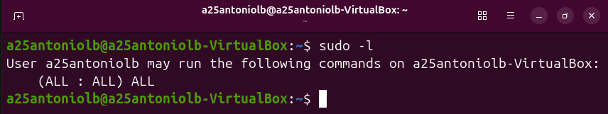

```bash
# Si dice que no tienes permisos de sudo, añádelos como root:
usermod -aG sudo <nome do usuario>
```

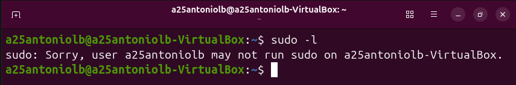

> **Aviso:** los cambios en `/etc/passwd`, `/etc/group` o `/etc/shadow` solo pueden hacerlos los usuarios **root**. Si editas cualquiera de esos archivos a mano y te equivocas en una línea, puedes dejar el sistema sin ninguna cuenta capaz de arrancar sesión. **Usa siempre las herramientas oficiales** (`useradd`, `usermod`, `passwd`, etc.).

---

## 3. Cómo se almacenan los usuarios

Antes de crear nada conviene saber dónde guarda Linux la información. Linux *no* usa una base de datos, sino **cuatro archivos de texto** en `/etc`, y la diferencia entre ellos explica qué hace cada comando:


| Archivo | Permisos | Contenido |
| --- | :-: | --- |
| `/etc/passwd` | `644` | Datos públicos de cada cuenta: nombre, UID, GID y shell. |
| `/etc/shadow` | `640` | Hash de la contraseña y fechas de caducidad. **Solo root**. |
| `/etc/group` | `644` | Grupos y sus miembros. |
| `/etc/skel` | `755` | Plantilla que se copia al crear el directorio personal. |


Cada línea de `/etc/passwd` tiene siete campos separados por dos puntos:

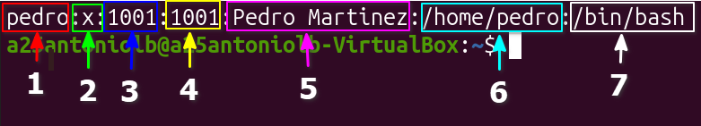

Para entender cada campo, veámoslo uno a uno con el ejemplo de `pedro`:


| Pos. | Campo | Valor de ejemplo | Significado |
| :-: | --- | --- | --- |
| 1 | Nombre de la cuenta | `pedro` | Identificador con el que el usuario inicia sesión. Debe ser único. |
| 2 | Contraseña | `x` | Marcador fijo. Indica que el hash real está en `/etc/shadow`. |
| 3 | UID | `1001` | Identificador numérico del usuario. `0` es `root` y los UID de servicio suelen ir por debajo de 1000. |
| 4 | GID | `1001` | Grupo principal del usuario. Equivale a lo que devuelve `id -gn`. `useradd` crea además un grupo propio con el mismo nombre. |
| 5 | Comentario | `Pedro Martinez` | Nombre real o descripción. Se muestra en `finger` y en el `ps` del sistema. |
| 6 | Directorio personal | `/home/pedro` | Ruta donde se guardan sus archivos. No tiene por qué existir: `useradd` solo la crea con `-m`. |
| 7 | Shell de inicio | `/bin/bash` | Programa que se ejecuta al iniciar sesión. `/usr/sbin/nologin` impide el acceso interactivo. |


Dos detalles que conviene destacar:

- El **UID** es el que el sistema usa internamente. Renombrar una cuenta cambia el campo 1, pero su UID sigue siendo el mismo, así que los archivos propiedad de `pedro` siguen siendo suyos aunque la cuenta pase a llamarse `pedro.martinez`.

- El **GID del campo 4** es solo el grupo principal. El usuario puede pertenecer a muchos más, y esos grupos adicionales se guardan en `/etc/group`, no en `passwd`. Por eso `/etc/passwd` es de lectura pública (`644`) y se puede consultar sin ser `root`, mientras que `/etc/shadow` es `640` y está restringido.

- El campo 2 es siempre una `x`: la contraseña **nunca** está en `passwd`, sino cifrada en `shadow`.

---

## 4. Procedimiento

### 4.1. Consultar el estado inicial

Antes de crear nada, mira cómo está el sistema para tener una referencia:

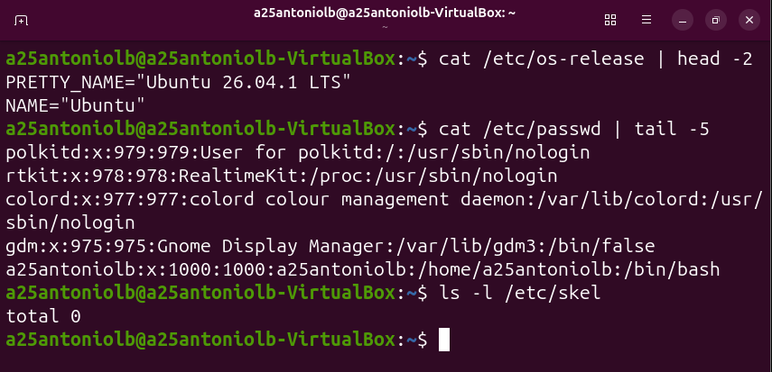

El directorio `/etc/skel` aparece vacío: es normal en una instalación recién hecha. Cualquier archivo que se añada ahí se copiará automáticamente al directorio personal de **todos** los usuarios que se creen en adelante.

### 4.2. Crear un usuario

Vamos a crear la cuenta de un compañero de trabajo llamado `pedro`. El comando es `useradd`, y cada opción cumple una función:

```bash
# Crear la cuenta de Pedro con directorio personal y shell interactivo
sudo useradd -m -c "Pedro Martinez" -s /bin/bash pedro
```

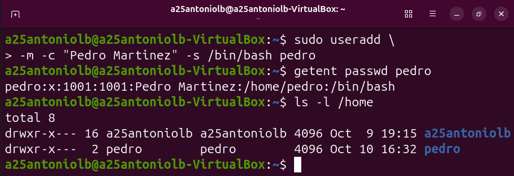

Puedes verificar la creación con `getent passwd pedro`, que devuelve exactamente la línea que se ha añadido a `/etc/passwd`.

> **Ojo con la opción `-m`.** Sin ella, `useradd` **crea la cuenta pero no el directorio personal**, y el usuario se encontraría sin `/home/pedro` al entrar. Compruébalo siempre con `ls -l /home`.

**Alternativa en Debian y Ubuntu:** `adduser`, más interactiva y con valores sensatos por defecto.

```bash
sudo adduser pedro          # pregunta datos, crea /home/pedro y ofrece un shell
sudo adduser --system web   # crea una cuenta de servicio directamente
```

### 4.3. Establecer la contraseña

Una cuenta recién creada está **sin contraseña**, así que no puede iniciar sesión. El comando `passwd` la establece:

```bash
# Establecer (o cambiar) la contraseña de Pedro
sudo passwd pedro

# Comprobar las políticas de caducidad configuradas
sudo chage -l pedro
```

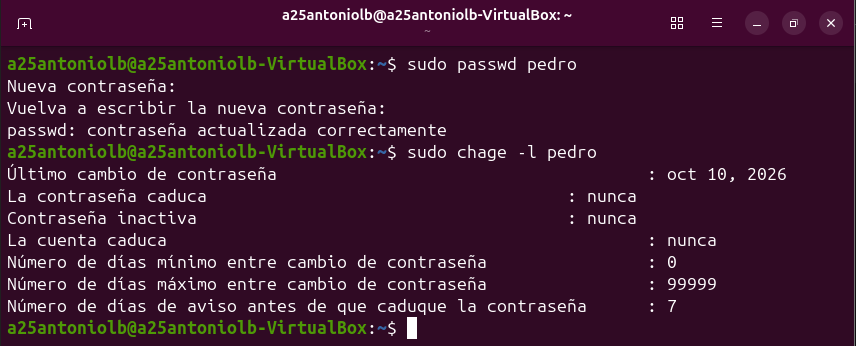

Fíjate en que `passwd` no muestra nada mientras escribes: es lo normal, evita que alguien vea tu contraseña por encima del hombro. Y **no** uses `passwd pedro MiContrasena`, porque quedaría guardada en el historial de comandos.

### 4.4. Gestión avanzada del estado de contraseñas

El comando `passwd` incluye modificadores esenciales para gestionar el estado operativo de las claves sin necesidad de esperar a que venza su caducidad global:

- **Forzar cambio en el próximo inicio de sesión (`sudo passwd -e pedro`)**: Si das de alta a un compañero y le asignas una clave temporal, puedes obligarle a cambiarla inmediatamente al entrar por primera vez.

- **Consultar el estatus de la clave (`sudo passwd -S pedro`)**: Muestra información rápida sobre el estado de la cuenta (si está bloqueada con una `L`, activa con una `P`, o no tiene clave con `NP`).

- **Eliminar la contraseña (`sudo passwd -d pedro`)**: Deja la cuenta sin contraseña. Esto hace que la cuenta sea accesible sin clave, lo cual es útil para pruebas controladas pero altamente inseguro en producción.

> **Aviso de seguridad**: Al usar `passwd -e`, el sistema cambia la fecha del último cambio de contraseña a `0` en `/etc/shadow`. Esto bloquea el acceso interactivo normal hasta que el usuario complete el proceso de actualización en el prompt de la terminal.

### 4.5. Añadir el usuario a grupos

En Linux los permisos no se dan por usuario, sino por **grupo**. `pedro` ya pertenece a su propio grupo; ahora la añadimos al grupo `soporte`:

```bash
# 1. Crear el grupo
sudo groupadd soporte

# 2. Añadir a pedro al grupo, conservando los que ya tenía
sudo usermod -aG soporte pedro

# 3. Comprobar la pertenencia
groups pedro
id pedro
grep soporte /etc/group
```

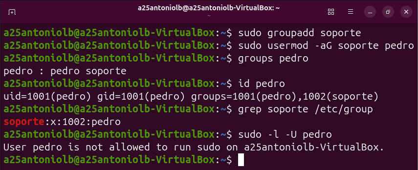

> **La opción `-aG` no es opcional.** `usermod -G soporte pedro` (sin la `a`) **borra** todos los demás grupos del usuario, y es posible que te quedes sin acceso a `sudo` o a tus propios archivos. Es el error más común al administrar usuarios: si la cuenta con la que estás trabajando deja de poder usar `sudo`, casi siempre la causa es un `-G` sin `-a`.

### 4.6. Crear una cuenta de servicio

No todos los usuarios son personas. Los servicios (un servidor web, una base de datos) también necesitan una cuenta propia, pero **no deben poder iniciar sesión**. Para eso se usa `-r` y un shell de bloqueo:

```bash
# Cuenta del sistema: sin directorio creado y sin poder iniciar sesión
sudo useradd -r -s /usr/sbin/nologin -c "Cuenta de servicio" servicioapp
```

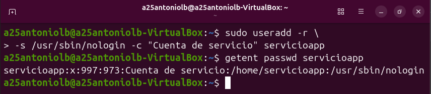

Con `-r` el sistema le asigna un UID bajo 1000 sin salir de la lista de UIDs reservados. Esas cuentas se identifican en `/etc/passwd` con nombres como `_apt` o `www-data`.

### 4.7. Fijar la caducidad y cambiar el directorio personal

Las políticas de contraseña se controlan con `chage`. En este ejemplo la clave de `pedro` caduca a los 90 días y se avisa 7 días antes:

```bash
# Mínimo 0 días entre cambios, máximo 90, aviso 7 días antes
sudo chage -m 0 -M 90 -W 7 pedro
sudo chage -l pedro
```

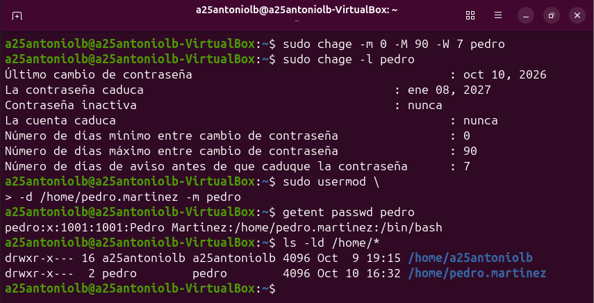

Si más adelante cambian el nombre o los apellidos de la persona, se cambia también su directorio. **Importante:** `usermod -d` sin `-m` solo reescribe la ruta en `passwd` y deja los archivos huérfanos en su ubicación antigua.

```bash
# Cambiar el directorio y MOVER los archivos existentes al nuevo directorio
sudo usermod -d /home/pedro.martinez -m pedro
```

### 4.8. Configuración de límites globales en /etc/login.defs

Aunque el comando `chage` permite definir la caducidad de contraseñas de forma individual por usuario, Linux cuenta con un archivo de configuración global donde se definen los valores por defecto para cualquier cuenta nueva que se cree en el sistema: `/etc/login.defs`.

Los parámetros más importantes dentro de este archivo que afectan a la gestión de usuarios son:

* **`PASS_MAX_DAYS`**: Número máximo de días que una contraseña es válida.
* **`PASS_MIN_DAYS`**: Número mínimo de días permitido entre cambios de contraseña.
* **`PASS_WARN_AGE`**: Días de aviso previos antes de que expire la clave.
* **`UID_MIN` y `UID_MAX`**: Rango de IDs que se asignarán a los usuarios normales (por defecto a partir de 1000 en Ubuntu).

Para consultar estos valores directos del sistema sin los comentarios del archivo, podemos filtrar el documento con `grep`:

```bash
# Filtrar las directivas activas de contraseñas en la configuración global
grep -E '^PASS_' /etc/login.defs
```

> **Nota:** Modificar estos valores solo afectará a los usuarios creados **después** del cambio. Los usuarios ya existentes mantendrán sus límites a menos que se actualicen manualmente con `chage`.

### 4.9. Comprobar y bloquear la cuenta

Antes de dar por buena una cuenta, conviene probar que funciona de verdad:

```bash
# Ejecutar un comando como si fueras Pedro
sudo -u pedro whoami

# Darle permisos de administrador añadiéndola al grupo sudo
sudo usermod -aG sudo pedro
sudo -l -U pedro
```

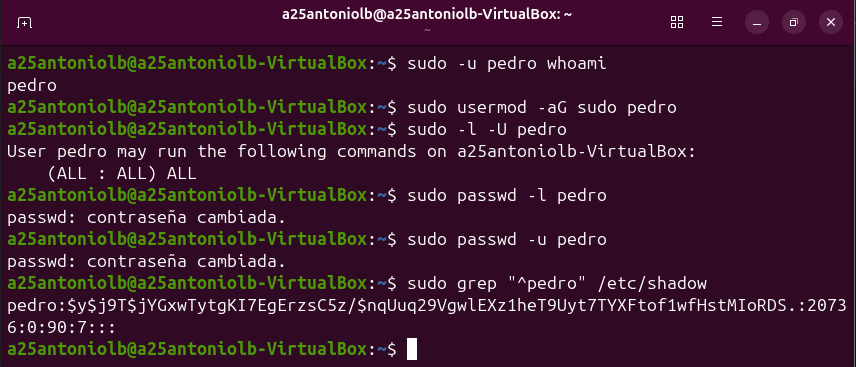

Cuando alguien se va de la empresa **no hace falta borrar su cuenta inmediatamente**: basta con bloquear el acceso y dejar los datos intactos un tiempo, por si hay que recuperar algún archivo.

```bash
sudo passwd -l pedro   # bloquea la contraseña anteponiendo ! al hash
sudo passwd -u pedro   # la desbloquea de nuevo
```

Y para consultar de un vistazo toda la política de seguridad de la cuenta:

```bash
sudo grep "^pedro" /etc/shadow
```

### 4.10. Eliminar la cuenta

Cuando ya no hay nada que recuperar, se elimina la cuenta. Aquí se ve la diferencia entre las dos formas de borrarla:

```bash
# Sin -r: borra la cuenta pero DEJA los archivos en /home
sudo userdel servicioapp
ls -ld /home/servicioapp

# Con -r: borra la cuenta, el directorio personal y el buzón de correo
sudo userdel -r pedro
```

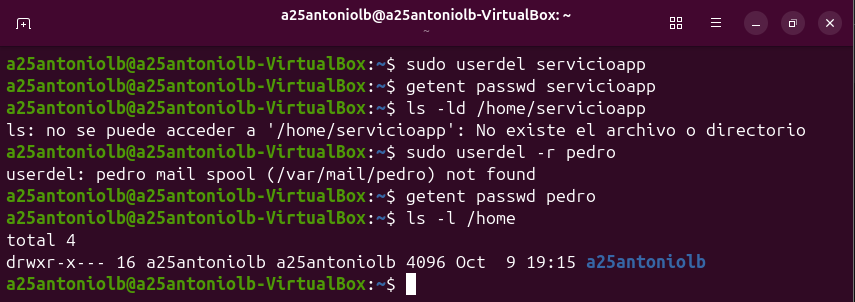

> **Aviso:** `userdel -r` *no pregunta confirmación*. Ejecutado sobre el usuario equivocado, el directorio personal se va al vertedero de forma inmediata. Comprueba siempre el nombre dos veces, y ten una copia de seguridad de `/home` si el directorio contiene trabajo importante.

---

## 5. Comprobación final

Un usuario que no puede iniciar sesión no es un usuario funcional. Estas seis comprobaciones cubren el procedimiento completo:


| # | Qué comprobar | Comando | Resultado esperado |
| :-: | --- | --- | --- |
| 1 | La cuenta existe | `getent passwd pedro` | Una línea con sus datos |
| 2 | El directorio personal es suyo | `ls -ld /home/pedro.martinez` | Dueño `pedro`, grupo `pedro` |
| 3 | La contraseña está establecida | `sudo passwd -S pedro` | Empieza por `P` (no `L` ni `NP`) |
| 4 | Los grupos son los correctos | `id pedro` | `pedro` y `soporte` |
| 5 | La shell es válida | `getent passwd pedro \| cut -d: -f7` | `/bin/bash` |
| 6 | El inicio de sesión funciona | `su - pedro` | Aparece la línea de orden de `pedro` |


Si las seis filas dan el resultado esperado, la cuenta está lista para usarse.

---

## 6. Resolución de problemas

### El usuario no aparece en los grupos nuevos

Los grupos se copian a la sesión **al iniciar sesión**: cierra la sesión del usuario y que vuelva a entrar. Si lo que quieres es compartir una carpeta, no cambies el dueño de todo su directorio personal, sino el grupo de la carpeta y su bit de herencia:

```bash
sudo chgrp -R soporte /srv/compartido
sudo chmod -R g+rwxs /srv/compartido
```

La `s` es el *setgid*: hace que los archivos nuevos hereden el grupo `soporte`.

### La cuenta ya existe o el directorio no está libre

Un `useradd` que falla con `UID already in use` o con `home directory already exists` significa que el identificador o la carpeta ya están ocupados. Comprueba el estado real antes de forzar nada:

```bash
getent passwd pedro
ls -ld /home/pedro
```

Si la cuenta existe pero la carpeta no, `useradd` no va a recrearla: usa `sudo mkdir -p /home/pedro && sudo chown pedro:pedro /home/pedro`.

### No se puede leer `/etc/shadow`

Es el comportamiento correcto: solo `root` puede leerlo. Necesitas `sudo`.

### He usado `usermod -G` y he perdido el grupo `sudo`

Ponte en cuenta con la sesión de recuperación (arranca con `init=/bin/bash`) o usa una cuenta de administración alternativa y recupera la pertenencia:

```bash
sudo usermod -aG sudo pedro
```

---

## 7. Resumen de comandos


| Comando | Función | Ejemplo |
| --- | --- | --- |
| `useradd` | Crear una cuenta | `sudo useradd -m -c "Pedro Martinez" pedro` |
| `adduser` | Crear una cuenta (interactivo) | `sudo adduser pedro` |
| `usermod` | Modificar una cuenta | `sudo usermod -aG soporte pedro` |
| `userdel` | Eliminar una cuenta | `sudo userdel -r pedro` |
| `passwd` | Establecer o bloquear la contraseña | `sudo passwd -l pedro` |
| `groupadd` | Crear un grupo | `sudo groupadd soporte` |
| `chgrp` | Cambiar el grupo propietario | `sudo chgrp soporte /srv/datos` |
| `chown` | Cambiar el usuario propietario | `sudo chown pedro /srv/datos` |
| `chage` | Política de caducidad de la contraseña | `sudo chage -M 90 pedro` |
| `id` / `groups` | Consultar grupos | `id pedro` |
| `getent` | Consultar la base de datos de usuarios | `getent passwd pedro` |


---

## 8. Referencias

- [Ubuntu — *User management*](https://documentation.ubuntu.com/server/how-to/security/user-management): guía oficial de Ubuntu sobre cuentas locales, grupos y permisos.
- [passwd](https://manpages.ubuntu.com/manpages/resolute/en/man5/passwd.5.html): formato de los archivos `/etc/passwd`, `/etc/shadow` y `/etc/group`.
- [useradd](https://manpages.ubuntu.com/manpages/resolute/en/man8/useradd.8.html): todas las opciones de creación de cuentas.
- [usermod](https://manpages.ubuntu.com/manpages/resolute/en/man8/usermod.8.html): todas las opciones de modificación de cuentas.
- [chage](https://manpages.ubuntu.com/manpages/resolute/en/man1/chage.1.html): gestión del caducidad de contraseñas y cuentas.
